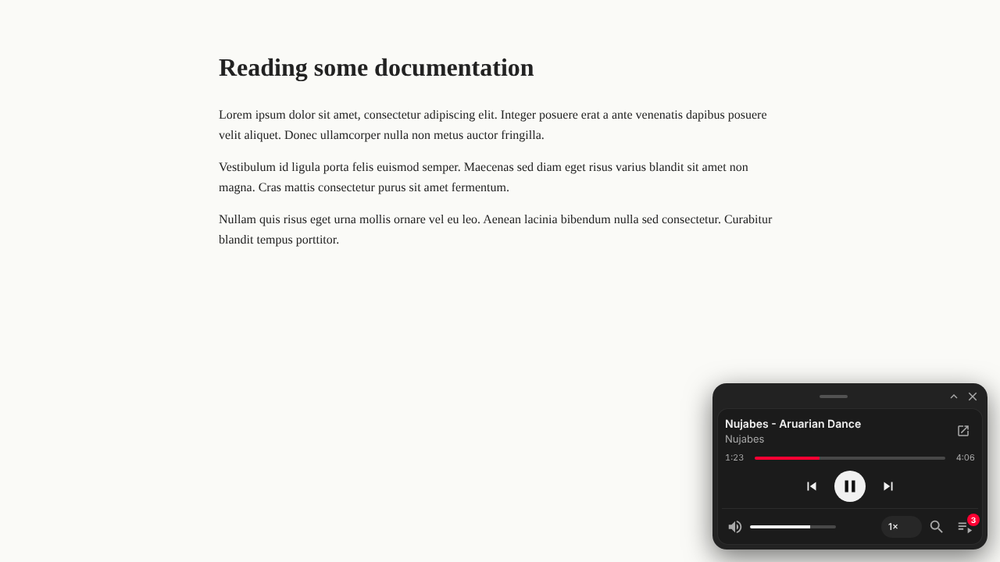
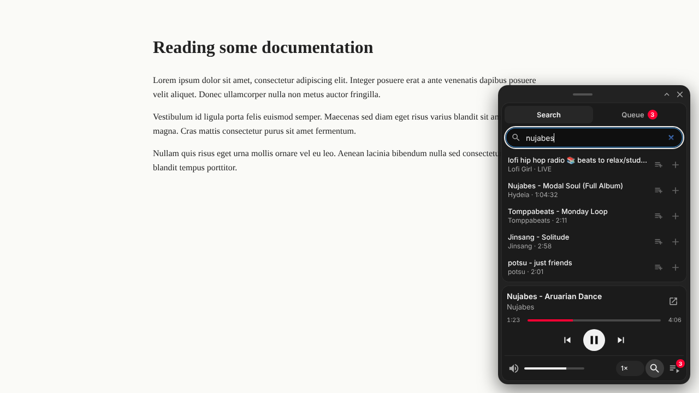
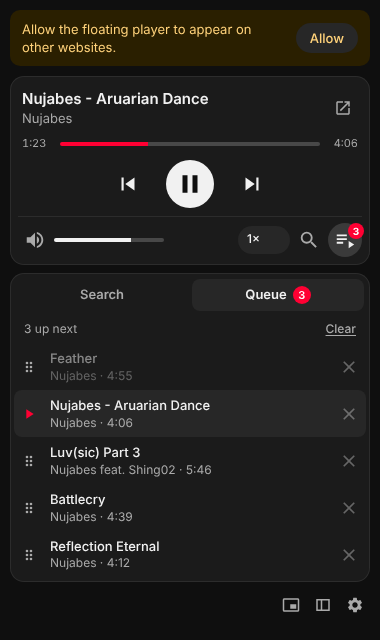
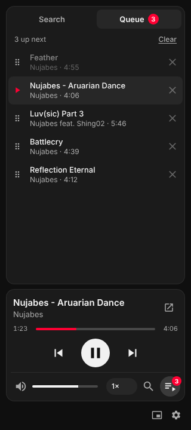
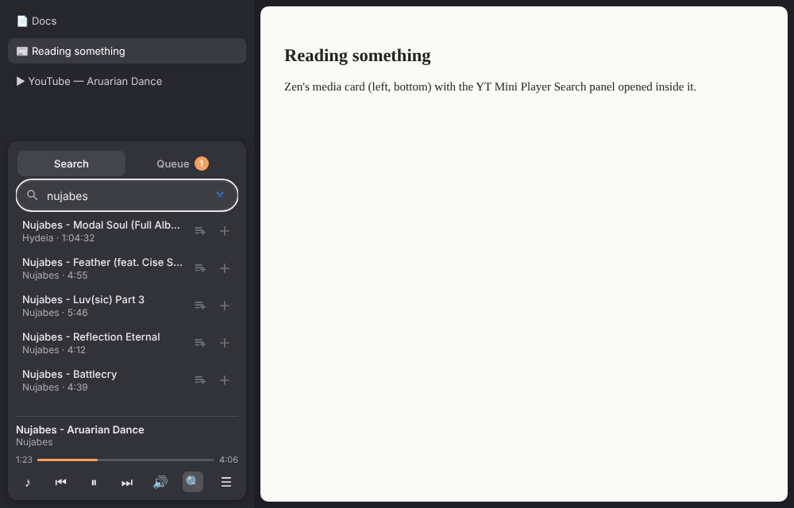

# YT Mini Player (Firefox / Zen)

A PiP-style **music player for regular YouTube**. It's a floating card that stays on top of the website you're reading. You can search YouTube, build your own queue and control playback without going back to the YouTube tab.

<p>
  
  
</p>
<p>
  
  
</p>

## Install in Zen (or Firefox)

**1. The extension**
1. Download the latest `yt_mini_player-*.xpi` from [Releases](https://github.com/hfzizz/YTPlayer/releases).
2. Drag it onto the Zen window, or go to `about:addons` → ⚙ → **Install Add-on From File…**.
3. The settings page opens. Click **Grant access** so the floating player can appear on websites.

**2. Zen only: Search and Queue on Zen's media card**
1. Install [Sine](https://github.com/CosmoCreeper/Sine) with its installer from the Releases page, then restart Zen.
2. In Zen's Settings, open the **Sine** section and turn on installing **JavaScript mods from unofficial sources**.
3. Add a mod from a repository by typing `hfzizz/zen-ytmini` (no folder), then restart Zen.
4. Check it: play a YouTube video and switch to another tab. Zen's media card at the bottom of the sidebar now has 🔍 and ☰. Settings → *Zen Browser* in the extension says **"Zen mod detected"**.

> **Why Sine?** Zen's built-in *Mods* setting only supports CSS (themes), and adding working buttons and a panel needs JavaScript. Sine adds JS-mod support to Zen. Without it you still get Zen's next/previous following your queue, and search/queue in the floating card, popup and sidebar.

## Features

- **Floating player card on every website.** Drag it anywhere, collapse it to one slim row, or hide it until the next song. It shows the title and channel only, with no video.
- **Search YouTube from the player.** Each result can be:
  - played now (click the row)
  - played next
  - added to the end of the queue (+)
- **Your own queue:**
  - drag to reorder, × to remove
  - saved between sessions
  - stops when it runs out
  - played songs stay visible, dimmed
- **Plays in the background.** If no YouTube tab is open, one is opened (pinned by default) to do the actual playing. It's shown for a moment, because Firefox won't start audio in a tab that was never visited, and then you're switched back.
- **Zen Browser and media keys.** Next/previous in Zen's built-in media player, and your keyboard's media keys, skip through **your queue**. With the optional [Zen mod](#zen-browser-extend-zens-media-player), Zen's media card also gets Search and Queue.
- **Controls:** seek, play/pause, previous/next, volume and mute, speed from 0.25× to 2×, captions.
- **Other places to use it:**
  - toolbar popup
  - Firefox/Zen sidebar (queue on top, player at the bottom)
  - detached window

  Each one can be turned on or off in the settings.
- **Toolbar badge:** shows ▶ / ❚❚ on the extension icon.
- **Global shortcuts** (rebind them in `about:addons` → ⚙ → *Manage Extension Shortcuts*):
  - `Alt+Shift+P`: play / pause
  - `Alt+Shift+→` / `Alt+Shift+←`: next / previous
  - `Alt+Shift+M`: open the mini window
- **Keys inside the popup, sidebar and window:**
  - `Space`/`K`: play/pause
  - `N` / `P`: next / previous
  - `M`: mute
  - `C`: captions
  - `←`/`→`: seek 5 seconds
  - `/`: search
  - `Q`: queue

## Zen Browser: extend Zen's media player

Zen has its own media card at the bottom of the sidebar. With the optional **Zen mod** [`hfzizz/zen-ytmini`](https://github.com/hfzizz/zen-ytmini), that card gets 🔍 **Search** and ☰ **Queue** buttons. Clicking one makes the card grow upward and shows our search or queue right inside it.



<sub>Mock-up: Zen's card is drawn in HTML here; the panel inside it is the real extension page.</sub>

**Why a mod?** Zen's media card is part of the browser's own interface, and extensions are sandboxed away from it. A Zen *mod* (a userChrome script) can change Zen's interface. This one is small: it adds the buttons and embeds the extension's panel page (`src/zen/panel.html`) in the card. Search, queue and playback all still run in the extension. The mod runs with full browser privileges, so read [`ytmini-zen.uc.js`](https://github.com/hfzizz/zen-ytmini/blob/main/ytmini-zen.uc.js) before installing it.

- **Next/previous on Zen's card follow your queue**, even without the mod.
- While the mod is active, our floating card hides itself, so you only see one player. You can turn this off in Settings → Zen Browser.

**Install:** follow the steps in [Install in Zen](#install-in-zen-or-firefox) above, or the [mod's README](https://github.com/hfzizz/zen-ytmini#install), which also covers manual fx-autoconfig installs and troubleshooting. If you installed the old copy from this repo (folder `zen-mod`), remove it in Sine first.

**Limits:**
- Zen only shows its media card while media plays in a tab you're *not* looking at. That's Zen's own behaviour. On the YouTube tab itself, use the toolbar popup.
- The buttons appear on every media card, not only YouTube's. They always control the YouTube player.
- Not working? Open the Browser Console (Ctrl+Shift+J), filter for `YT Mini`, and see the [troubleshooting table](https://github.com/hfzizz/zen-ytmini#troubleshooting).

## Releasing a signed build (maintainer)

Firefox and Zen only keep extensions permanently if Mozilla has signed them. Signing as an *unlisted* add-on is free and doesn't publish anything on the add-ons store.

One-time setup:
1. Create API keys at <https://addons.mozilla.org/developers/addon/api/key/> (sign in with a Firefox account).
2. In this repo, go to **Settings → Secrets and variables → Actions** and add two secrets: `AMO_JWT_ISSUER` (the "JWT issuer") and `AMO_JWT_SECRET` (the "JWT secret").

For each release:
1. Bump `version` in `manifest.json`. Mozilla won't sign the same version twice.
2. Go to **Actions → Release signed extension → Run workflow**, or push a tag like `v0.3.0`.
3. After a few minutes, the signed `.xpi` appears under [Releases](https://github.com/hfzizz/YTPlayer/releases).

Locally: `AMO_JWT_ISSUER=… AMO_JWT_SECRET=… npm run sign` writes the `.xpi` to `dist/`.

## Install (development)

1. In Firefox or Zen, open `about:debugging#/runtime/this-firefox`.
2. Click **Load Temporary Add-on…** and select `manifest.json` in this folder.
3. The settings page opens. Click **Grant access** so the floating player can appear on websites.
4. Click the toolbar icon, search for something, and press a result to play it.

Or, with Node.js installed:

```sh
npm install
npm start        # launches Firefox with the extension loaded (web-ext run)
npm test         # queue engine + search parser unit tests
npm run lint     # web-ext lint
npm run build    # zip into web-ext-artifacts/
```

Requires Firefox 128 or later, or a Zen version based on it.

## How it works

```
YouTube tab (plays the audio)        background.js                         UIs
┌──────────────────────┐  port "yt"  ┌──────────────────────┐  port "ui"  ┌───────────────────────┐
│ content/youtube.js   │ ──state──▶  │ queue engine         │ ──state──▶  │ floating card /       │
│ player API, <video>, │ ──ended──▶  │ (storage.local)      │ ──queue──▶  │ popup / sidebar /     │
│ Media Session        │ ◀──load───  │ search (search.js)   │ ◀─search──  │ window                │
│                      │ ◀──cmds───  │ opens player tab     │ ◀──cmds───  │ (shared/player-ui.js) │
└──────────────────────┘             └──────────────────────┘             └───────────────────────┘
```

- **Search** (`src/search.js`) calls YouTube's own web search API from the background page, falling back to parsing the results page. Results are video-only.
- **Queue** (`src/background.js`): when a song ends, the YouTube tab reports it, the extension cancels YouTube's autoplay countdown and loads the next queued video. It uses YouTube's in-page navigation, so there's no reload. With nothing left in the queue, playback stops.
- **Zen / media keys:** the YouTube-tab script takes over the page's Media Session next/previous handlers while your queue is active.
- `src/content/selectors.js` holds every YouTube DOM selector. If something stops working after a YouTube update, look there first.

## Permissions

| Permission | Why |
| --- | --- |
| `*://*.youtube.com/*` | Control the YouTube player and search YouTube |
| `tabs` | Open, find and focus the player tab and the mini window |
| `storage` | Settings, queue, card and window position |
| `scripting` | Register the floating player on websites |
| `<all_urls>` (optional) | Only for the floating player on other websites |

## Known limits

- Firefox doesn't let extensions create a real always-on-top window, so the floating card stays on top inside the browser, not over other apps.
- The extension alone can't add a search box or queue to Zen's own media player, because that's Zen's interface. The optional [Zen mod](#zen-browser-extend-zens-media-player) does it.
- If Firefox still blocks audio in the player tab, the card shows a notice. Open the tab once, or allow autoplay for youtube.com using the permissions icon in the address bar.
